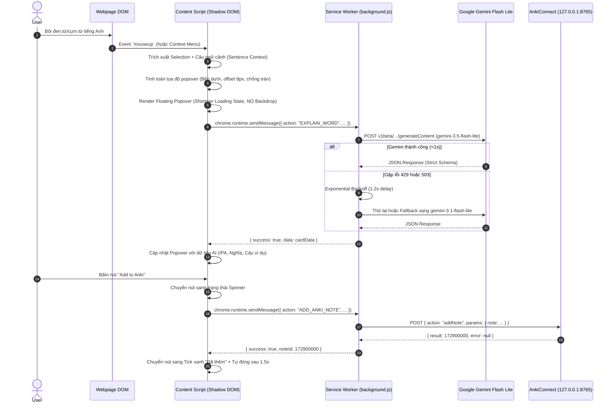

# ARCHITECTURE.md: Kiến trúc Hệ thống Anki AI Vocab Extension (Manifest V3)

Tài liệu thiết kế kiến trúc kỹ thuật dành cho Chrome Extension Manifest V3 tích hợp Google Gemini Flash Lite và AnkiConnect, hỗ trợ bóc tách ngữ nghĩa từ vựng theo ngữ cảnh và hiển thị qua Compact Floating Popover (không che tab).

---

## 1. Tổng quan Kiến trúc (High-Level Architecture)

Hệ thống hoạt động theo mô hình phân tầng hướng sự kiện (Event-driven Layered Architecture) chuẩn Manifest V3:

```
┌─────────────────────────────────────────────────────────────────────────────┐
│                             BROWSER VIEWPORT                                │
│                                                                             │
│  [Webpage DOM]                                                              │
│       │                                                                     │
│  (User selects text / mouseup)                                              │
│       ▼                                                                     │
│  [Content Script Layer]                                                     │
│   ├── Context Extractor (DOM traversal, sentence boundary detection)       │
│   ├── Shadow DOM Container (100% CSS Encapsulation, #anki-floating-host)    │
│   └── Compact Floating Popover (Dynamic positioning, viewport collision)    │
└──────────────────────────────────────┬──────────────────────────────────────┘
                                       │ chrome.runtime.sendMessage
                                       ▼
┌─────────────────────────────────────────────────────────────────────────────┐
│                    BACKGROUND SERVICE WORKER LAYER                          │
│                                                                             │
│  [background.js (Message Dispatcher & Lifecycle Manager)]                   │
│   ├── [AI Service Module (ai-service.js)]                                   │
│   │    ├── Primary Engine: Gemini 3.5 Flash Lite                            │
│   │    ├── Fallback Engine: Gemini 3.1 Flash Lite                           │
│   │    ├── Exponential Backoff & 429 / 503 Retry Handler                    │
│   │    └── Structured JSON Parser & Cleaner                                 │
│   │                                                                         │
│   ├── [Anki Service Module (anki-service.js)]                               │
│   │    ├── HTTP Client (POST http://127.0.0.1:8765)                         │
│   │    ├── AnkiConnect Actions: version, deckNames, modelNames, addNote     │
│   │    └── Dynamic Field Mapping Interpolator                               │
│   │                                                                         │
│   └── [Storage Module (storage.js / config.js)]                             │
│        └── chrome.storage.sync (API Key, Model, Deck, Note Type, Mapping)   │
└───────────────────────┬───────────────────────────────┬─────────────────────┘
                        │ HTTP POST (v1beta API)        │ HTTP POST (Port 8765)
                        ▼                               ▼
       ┌────────────────────────────────┐    ┌────────────────────────────────┐
       │   Google Gemini REST API       │    │     Local AnkiConnect Client   │
       │  (gemini-3.5-flash-lite)       │    │      (Anki Desktop Instance)   │
       └────────────────────────────────┘    └────────────────────────────────┘
```

---

## 2. Phân tầng Trách nhiệm (Separation of Concerns)

### 2.1. Content Script Layer (`content/`)
- **Trách nhiệm duy nhất:** Tương tác DOM, bắt vị trí con trỏ chuột/bôi đen, tính toán tọa độ viewport, và hiển thị giao diện người dùng.
- **Quy tắc cách ly CSS:** Toàn bộ giao diện Floating Popover được đặt bên trong `ShadowRoot` (`mode: 'open'`). Không kế thừa CSS của trang web cha, không làm rò rỉ style ra trang web.
- **Quy tắc không che tab (Non-blocking):**
  - **TUYỆT ĐỐI KHÔNG** tạo backdrop mờ hoặc overlay phủ toàn màn hình (`inset: 0`, `position: fixed` che phủ).
  - Không khóa cuộn trang (`body.overflow = 'hidden'` bị cấm).
  - Tọa độ gắn theo `absolute` với `window.scrollX` / `window.scrollY` hoặc `fixed` bám theo tọa độ vùng bôi đen `range.getBoundingClientRect()`.
  - Tự động đóng khi nhấn phím `Escape` hoặc khi click ra ngoài (`click outside`).

### 2.2. Background Service Worker Layer (`background/`)
- **Trách nhiệm:** Đóng vai trò là API Gateway bảo mật và trung gian truyền thông tin.
- **Bảo mật & CORS:**
  - Thực hiện mọi lệnh gọi mạng `fetch()` đến Google Gemini API và AnkiConnect (`http://127.0.0.1:8765`) để tránh lỗi CORS và không làm lộ API Key vào DOM của trang web.
- **Tối ưu hóa Hạn mức & Phục hồi lỗi (Resilience & Quota Optimization):**
  - Sử dụng mô hình chính: `gemini-3.5-flash-lite` (tối ưu hóa hạn mức Free 500 RPD, 15 RPM).
  - Bộ điều khiển thử lại thông minh (Exponential Backoff with Jitter) khi gặp HTTP 429 hoặc HTTP 503.
  - Tự động chuyển vùng dự phòng sang `gemini-3.1-flash-lite` trước khi trả lỗi về giao diện.
- **Quản lý Context Menu:**
  - Tự động nạp động (Dynamic Script Injection Fallback) nếu tab được mở trước khi nạp extension.

### 2.3. Options & Configuration Layer (`options/`)
- Quản lý cấu hình lưu trữ lâu dài trong `chrome.storage.sync`.
- Cấu hình API Key, chọn model, chọn Deck mục tiêu, Note Type mục tiêu, và ánh xạ trường (Field Mapping).

### 2.4. Shadow DOM Design Tokens (Shadcn / Zinc Minimalist System)
Giao diện Shadow DOM tuân thủ nghiêm ngặt bảng token tối giản phong cách Shadcn UI, loại bỏ hoàn toàn các hiệu ứng glow/neon/gradient:
- **Light Theme Tokens:**
  - Surface: `--popover-bg: #FFFFFF`
  - Border: `--border: #E4E4E7` (Zinc-200, viền sắc 1px)
  - Typography: `--text-primary: #09090B` (Zinc-950, weight 600), `--text-secondary: #71717A` (Zinc-500)
  - Badge POS: `--badge-bg: #F4F4F5`, `--badge-text: #18181B`
  - Action Button: `--btn-bg: #18181B`, `--btn-text: #FAFAFA`, `--btn-hover: #27272A`
- **Dark Theme Tokens (`@media (prefers-color-scheme: dark)`):**
  - Surface: `--popover-bg: #09090B` (Zinc-950)
  - Border: `--border: #27272A` (Zinc-800, viền sắc 1px)
  - Typography: `--text-primary: #F4F4F5` (Zinc-100), `--text-secondary: #A1A1AA` (Zinc-400)
  - Badge POS: `--badge-bg: #27272A`, `--badge-text: #E4E4E7`
  - Action Button: `--btn-bg: #FAFAFA`, `--btn-text: #18181B`, `--btn-hover: #E4E4E7`
- **Structure Metrics:**
  - Border radius: `8px` (`--radius: 8px`)
  - Elevation: `box-shadow: 0 4px 20px -2px rgba(0, 0, 0, 0.08), 0 2px 6px -1px rgba(0, 0, 0, 0.04)`
  - Custom Slim Scrollbar: `width: 4px; border-radius: 2px`

---

## 3. Cấu trúc Thư mục Module hóa (Project Directory Structure)

```text
Ex/
├── ARCHITECTURE.md             # Kiến trúc kỹ thuật và sơ đồ luồng hệ thống
├── SPEC.md                     # Đặc tả kỹ thuật Schema JSON, API & Error handling
├── TASKS.md                    # Danh sách micro-tasks triển khai chi tiết
├── README.md                   # Hướng dẫn cài đặt và sử dụng
├── manifest.json               # Chrome Extension Manifest V3 configuration
├── icons/                      # Bộ icons chuẩn của Chrome Extension
│   ├── icon16.png
│   ├── icon32.png
│   ├── icon48.png
│   ├── icon128.png
│   └── icon.svg
├── background/                 # Background Service Worker Modules
│   ├── background.js           # Entry point, event routing, context menu
│   ├── config.js               # Default settings & schema constants
│   ├── ai-service.js           # Gemini Flash Lite client, quota & retry engine
│   └── anki-service.js         # AnkiConnect HTTP client & field interpolator
├── content/                    # Content Script Modules
│   ├── content.js              # DOM selection, sentence extractor, popover logic
│   ├── popover-ui.js           # Shadow DOM component builder & renderer
│   ├── position-calculator.js  # Viewport collision detection & coordinates
│   └── content.css             # Scoped CSS styling inside Shadow Root
├── options/                    # Extension Options Page
│   ├── options.html            # Cấu hình API key, Anki deck, field mapping
│   ├── options.css             # Dashboard styling
│   └── options.js              # Options controller logic
└── popup/                      # Quick status / Manual lookup toolbar popup
    ├── popup.html              # Mini widget popup
    ├── popup.css              # Compact popup style
    └── popup.js               # Status check & manual lookup
```

---

## 4. Luồng Dữ liệu Chi tiết (Data Flow Sequence)



---

## 5. Nguyên tắc Kỹ thuật Trọng yếu (Key Engineering Principles)

1. **Zero Layout Distortion:** Popover chèn qua Shadow Root độc lập gắn vào `document.documentElement`, vị trí tính tuyệt đối, không ảnh hưởng layout và scrollbar của website.
2. **Strict Quota Efficiency:** Sử dụng `gemini-3.5-flash-lite` với prompt tối giản để giảm Input/Output tokens, duy trì dưới ngưỡng 250K TPM và đạt tốc độ phản hồi tối đa.
3. **Graceful Degradation:** Mọi điểm nghẽn (Gemini nghẽn tải, Anki chưa mở, AnkiConnect chưa cấu hình CORS) đều có cơ chế phát hiện và hiển thị hướng dẫn khắc phục chính xác ngay tại giao diện.

